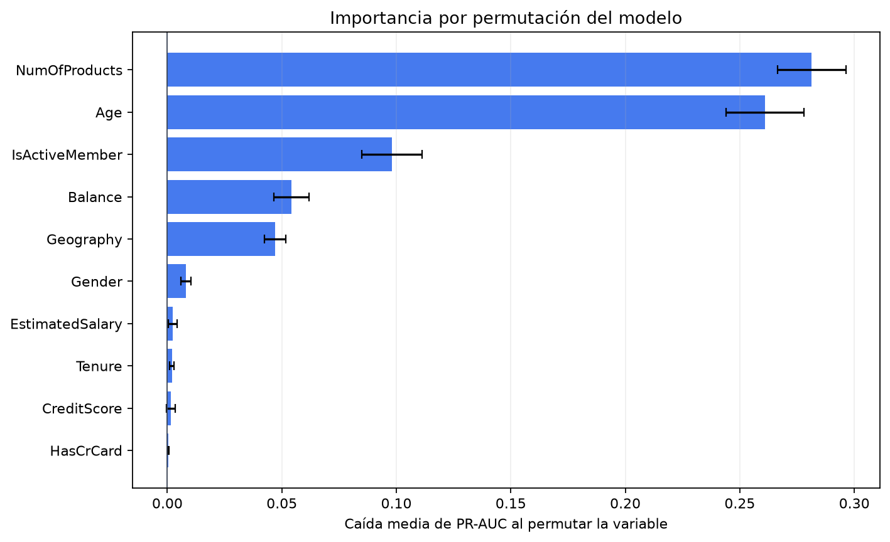

# FinanceGuard — Churn Decision System

Proyecto de portfolio que transforma un ejercicio académico de predicción de fuga de clientes en un sistema reproducible de apoyo a decisiones de retención.

## Qué resuelve

El modelo estima la probabilidad de abandono de cada cliente. La salida no se limita a una clasificación: el proyecto selecciona el umbral de intervención según el costo de contactar, el valor de retener a un cliente y la efectividad esperada de la campaña.

## Diseño metodológico

- El conjunto de test queda aislado del ajuste y la selección de modelos.
- El preprocesamiento vive dentro de `Pipeline`, evitando fugas de información.
- La selección de modelos usa validación cruzada sobre desarrollo.
- PR-AUC se utiliza como criterio principal debido al desbalance de la clase positiva.
- El umbral se elige con predicciones out-of-fold, no con el conjunto de test.
- La decisión puede maximizar beneficio esperado o respetar una capacidad máxima de contacto.
- Se reportan ROC-AUC, PR-AUC, Brier score, precision, recall, F1, lift y matriz de confusión.
- La segmentación del trabajo original se conserva como hallazgo exploratorio, no como evidencia de “segmentos naturales”.

## Resultados de referencia

El modelo seleccionado fue `HistGradientBoosting`, con PR-AUC medio de 0,7004 en validación cruzada.

Para una campaña limitada al 20% de la cartera:

| Indicador | Resultado |
|---|---:|
| Umbral seleccionado | 0,325 |
| ROC-AUC test | 0,8704 |
| PR-AUC test | 0,7196 |
| Precision | 0,6423 |
| Recall | 0,6265 |
| F1 | 0,6343 |
| Lift al 10% | 4,1278 |
| Clientes contactados | 19,85% |

Bajo los supuestos ilustrativos utilizados, limitar la campaña al 20% reduce los contactos aproximadamente un 47% respecto del máximo beneficio sin restricciones, pero conserva cerca del 85% del beneficio esperado.

## Explicabilidad del modelo

La importancia por permutación mide cuánto disminuye el PR-AUC cuando se desordena una variable, manteniendo las demás sin cambios.



`NumOfProducts` y `Age` son las variables con mayor aporte predictivo, seguidas por `IsActiveMember`, `Balance` y `Geography`. La importancia representa utilidad predictiva dentro del modelo y no implica una relación causal.

El gráfico puede regenerarse con:

```bash
python -m financeguard.explain \
  --data data/raw/Churn_Modelling.csv
```

## Estructura

```text
data/raw/                  dataset local (ignorado por Git)
models/                    modelos entrenados (ignorados por Git)
reports/metrics/           resultados reproducibles
src/financeguard/          código reutilizable
tests/                     pruebas automáticas
legacy/                    contexto de la entrega académica original
```

## Inicio rápido

Requiere Python 3.11 o superior.

```bash
python -m venv .venv
source .venv/bin/activate        # Windows: .venv\Scripts\activate
pip install -e ".[dev]"
financeguard-train --data data/raw/Churn_Modelling.csv
python -m unittest discover -s tests -v
```

Los supuestos económicos se pueden modificar desde la línea de comandos:

```bash
financeguard-train \
  --data data/raw/Churn_Modelling.csv \
  --contact-cost 10 \
  --retained-customer-value 250 \
  --campaign-success-rate 0.30
```
Escenario con capacidad máxima para contactar al 20% de la cartera:

```bash
financeguard-train \
  --data data/raw/Churn_Modelling.csv \
  --max-contact-rate 0.20
```

## Interpretación del umbral económico

Para cada umbral se estima:

`beneficio = verdaderos_positivos × valor_cliente × efectividad − contactos × costo_contacto`

Es una simulación y no una estimación causal. Antes de producción habría que reemplazar estos supuestos por costos reales, medir la respuesta de campaña mediante experimentos y validar estabilidad temporal.

La tasa de efectividad de campaña es un supuesto configurable porque el dataset no contiene información sobre intervenciones de retención. El modelo predice riesgo de churn, pero no estima causalmente qué clientes permanecerían como consecuencia del contacto.

## Datos

El archivo original se espera en `data/raw/Churn_Modelling.csv`. Por trazabilidad, los campos `RowNumber`, `CustomerId` y `Surname` se excluyen del modelado. El dataset no contiene tiempo, campañas ni transacciones; por eso este repositorio demuestra una arquitectura analítica, pero no pretende simular un despliegue bancario real.

## Próximas mejoras

1. Explicaciones globales e individuales con *permutation importance* y SHAP.
2. Aplicación Streamlit para priorizar campañas y exportar clientes.
3. Monitoreo de deriva y desempeño con datos temporales.
4. Pruebas de equidad y documentación de gobierno del modelo.

## Autor

Dimas Giménez — proyecto individual, reconstruido a partir de la entrega académica de Data Analytics / Machine Learning.

## Licencia

El código de este proyecto se distribuye bajo la licencia MIT. El dataset no forma parte de la distribución y debe obtenerse por separado respetando las condiciones de su fuente.